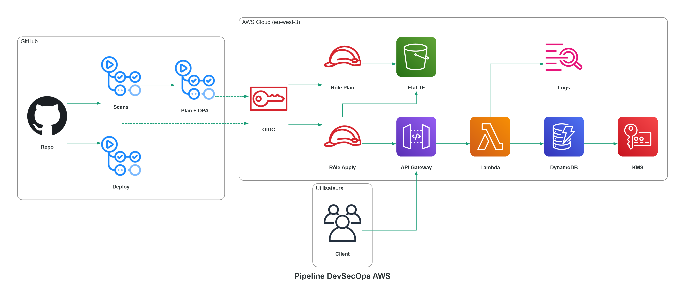

<div align="center">

# 🔐 Pipeline DevSecOps serverless sur AWS

**Chaîne de livraison sécurisée : déploiement sans aucune clé AWS stockée, blocage automatique des secrets, du code vulnérable, des CVE et de l'infrastructure non conforme.**

Projet personnel : profil DevSecOps & Cloud Security, ENSIAS, filière Cybersecurity, Cloud & Mobile Computing (2026)


[Décisions de sécurité](docs/security-decisions.md)

</div>

> Déployer dans le cloud depuis une CI expose deux risques majeurs : des clés d'accès qui fuient, et du code ou de l'infrastructure non conformes qui arrivent en production.
> Ce pipeline supprime le premier risque (aucune clé, uniquement des identifiants temporaires via OIDC) et **bloque le second avant la fusion**, avec des preuves à l'appui.
> L'application (une API de tâches) est volontairement simple : **la valeur du projet est dans la chaîne de livraison**.

---

## Points clés

- **Zéro clé AWS** : GitHub Actions s'authentifie par **OIDC** ; conditions IAM exactes, sans joker, avec les identifiants immuables du dépôt (anti repo-jacking).
- **Deux rôles séparés** : un rôle **plan** en lecture seule pour les pull requests, un rôle **apply** réservé à `main`, qui ne peut pas modifier sa propre chaîne de confiance.
- **5 contrôles bloquants sur chaque PR** : Gitleaks, Semgrep, Trivy, pytest, Checkov.
- **5 règles OPA écrites et testées** (31 tests), appliquées au **plan Terraform réel**.
- **Moindre exposition** : une PR dont les scans échouent n'obtient **jamais** d'accès AWS.
- **Fusion impossible** tant que les contrôles ne sont pas verts (checks obligatoires sur `main`).
- **Un incident réel géré**, avec post-mortem : le moindre privilège a empêché les dégâts.

## Architecture

<p align="center">
  
</p>

| Flux | Déroulement |
|---|---|
| **Pull request** (`pr.yml`) | Scans **sans accès AWS** → si tout passe : OIDC (rôle **plan**), `terraform plan`, règles OPA (Conftest), résumé du plan en commentaire |
| **Fusion sur `main`** (`deploy.yml`) | OIDC (rôle **apply**) → `terraform plan` puis `apply` de ce plan → smoke test : requête signée **200**, non signée **403** |
| **Application** | API Gateway HTTP (autorisation IAM) → 4 Lambda Python (un rôle IAM chacune) → DynamoDB chiffrée par CMK KMS, PITR activé |

## Preuves

| Ce qui est garanti | Preuve |
|---|---|
| Déploiement sans clé (OIDC, identifiants temporaires) | [Déploiement vert](docs/screenshots/02-deploy-vert.png) |
| L'API n'est pas publique (200 signé, 403 non signé) | [Smoke test](docs/screenshots/03-smoke-200-403.png) |
| Une PR non conforme ne peut pas être fusionnée | [Fusion bloquée](docs/screenshots/04-pr-bloquee-merge-desactive.png) |
| Chaque outil bloque son défaut | [5 étapes en échec](docs/screenshots/05-demo-v2-5-outils-rouges.png) · [Gitleaks](docs/screenshots/06-gitleaks.png) |
| Les règles OPA bloquent ce que les outils génériques laissent passer | [Scans verts, OPA rouge](docs/screenshots/12-opa-scans-verts-plan-rouge.png) · [Message Conftest](docs/screenshots/12b-opa-conftest-fail.png) |
| Le plan est publié sur chaque PR, sans valeur sensible | [Commentaire du plan](docs/screenshots/13-commentaire-plan.png) |

## Règles OPA (Rego v1)

| # | Règle | Particularité |
|---|---|---|
| 1 | Tags `Project`, `Owner`, `Environment` obligatoires | Un tag vide ou `null` compte comme absent |
| 2 | Région **eu-west-3** uniquement | Vérifiée sur le provider **et** sur chaque ressource (provider AWS ≥ 6) |
| 3 | Aucune action ni ressource `*` dans un `Allow` IAM | `NotAction` / `NotResource` détectés ; un `Deny` avec `*` reste permis |
| 4 | DynamoDB : **CMK** et **PITR** | Distingue une CMK créée dans le même plan d'une clé gérée par AWS |
| 5 | Logs : rétention entre 1 et 30 jours | `0` (conservation illimitée chez AWS) est refusé |

## Décisions de sécurité

- **Chaîne d'approvisionnement** : actions GitHub épinglées par SHA, binaires des outils vérifiés par SHA-256, versions figées (Terraform, providers, Python).
- **Séparation des privilèges** : préfixes distincts (`-dev-*` pour l'application, `-ci-*` pour la CI) et `Deny` explicite contre l'escalade.
- **Données** : DynamoDB chiffrée par CMK ; état Terraform dans S3 chiffré, versionné, sans accès public, TLS obligatoire, verrouillage natif.
- **Exceptions justifiées** : chaque règle Checkov ignorée est documentée.

Détail complet : [`docs/security-decisions.md`](docs/security-decisions.md)

## Incident réel

Une PR de démonstration vulnérable a été fusionnée : les contrôles n'étaient pas déclarés obligatoires.
**Le moindre privilège du rôle de déploiement a bloqué les dégâts** : la politique `Action: "*"` et le bucket non chiffré n'ont jamais été créés.
Correction par revert (sans réécriture d'historique) et checks rendus obligatoires. Le post-mortem est dans [`docs/security-decisions.md`](docs/security-decisions.md).

## Stack

Terraform · GitHub Actions · AWS (Lambda, API Gateway, DynamoDB, KMS, S3, IAM, STS) · Python 3.12 / Pydantic · pytest + moto · Gitleaks · Semgrep · Trivy · Checkov · OPA / Conftest · LocalStack

## Structure

```
app/                 API Python : handlers, modèles Pydantic, tests
infra/               Terraform : modules api, lambda, dynamodb, iam
infra/bootstrap/     État S3, fournisseur OIDC, rôles CI (appliqué une fois)
policies/            Règles OPA et leurs tests
.github/workflows/   pr.yml (contrôles) · deploy.yml (déploiement)
docs/                Décisions de sécurité, architecture, captures
```

## Limites connues et suite

- Réduire le rôle apply à partir de CloudTrail et d'IAM Access Analyzer (notamment `kms:*` sur `key/*`).
- Rendre le build Lambda reproductible pour éviter des redéploiements inutiles.
- Mettre à jour les actions GitHub vers leurs versions Node 24.
- Phases suivantes : audit de posture (Prowler), détection (CloudTrail, GuardDuty, EventBridge) testée avec Stratus Red Team.
